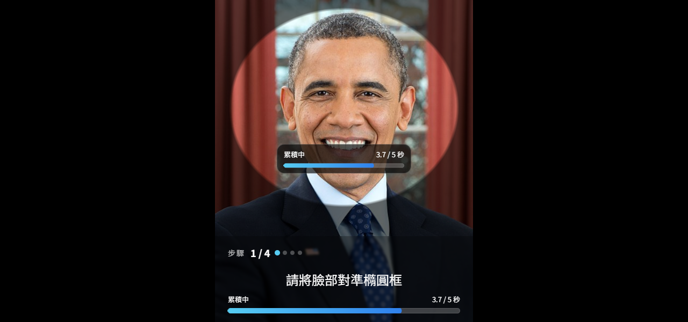

# HtmlFaceLandmark

這個 Demo 截取自我過去專案中的手機端人臉動作檢測功能，整理成獨立頁面，方便在面試時展示實作並說明開發內容。

原始實作整合 MediaPipe FaceLandmarker 的 WebAssembly 執行環境，取得人臉特徵與眼部動作分數，依門檻引導使用者完成動作，並透過 MediaRecorder 側錄攝影機畫面。

Demo 引導使用者對準橢圓框、稍微左轉頭、稍微右轉頭，以及抬頭；後三步皆維持注視螢幕，完成後可預覽並下載 Blob 影片。目前以眼部動作分數判定，未驗證頭部角度或實際注視點。

這次使用 AI 協助將原專案中的功能整理為可獨立展示的版本，包含介面精簡、PC 操作、錄影收尾與下載。動作改為累積達標五秒，未達標時暫停、保留進度；第一步限制臉部特徵位於比橢圓框放大 10% 的範圍內，左右視線門檻為 0.45，下看為 0.75，過場時間保持不變。

## PC 版畫面

PC 瀏覽器會將畫面限制為置中、最寬 480px 的直式區塊，高度與視窗相同；PC 常見的 16:9 鏡頭畫面會以 `object-fit: cover` 裁切顯示。下圖為 1280×600 視窗，以模擬攝影機輸入人臉影像時的步驟 1 畫面：

